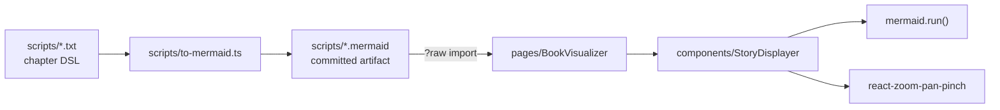

# AGENTS.md

Companion web app for **La Saga de Dagda**, the interactive gamebook series by
Fabien Olicard. Readers use it to visualise the branching chapter graph of each
book and to keep track of their character sheet. Everything runs client-side;
there is no backend, no API and no database.

The user-facing README is French. This file and everything under `docs/` are in
English, and describe the repository as it currently is (including the parts
that are unfinished).

---

## Stack

Vite 7 + React 19 + TypeScript, Chakra UI v3 for every component, `mermaid` for
diagram rendering and `react-zoom-pan-pinch` for the pan/zoom canvas. Packaged
as a PWA with `vite-plugin-pwa` and deployed to GitHub Pages under the base path
`/grimoire-de-dagda/`.

Package manager is **pnpm** (`packageManager: pnpm@10.21.0`). Do not use npm or
yarn.

## Commands

| Command | What it does |
| --- | --- |
| `pnpm dev` | Dev server on port 3000 |
| `pnpm build` | `tsc -b && vite build` — type errors fail the build |
| `pnpm lint` | ESLint (flat config, `strictTypeChecked`) |
| `pnpm format` | Prettier write over the whole repo |
| `pnpm preview` | Serve the production build |

There is **no test runner**. Do not assume `pnpm test` exists; if you need to
verify a change, `pnpm build` and `pnpm lint` are the available gates.

Regenerating the chapter diagrams has no pnpm script either. It must be run from
inside `scripts/`, because the generator reads its inputs relative to the module
URL but writes its outputs relative to the current working directory:

```sh
cd scripts && node to-mermaid.ts
```

## Layout

```
scripts/                      Book data + diagram generator (not part of the app build)
  *.txt                       Chapter graph source, in a custom DSL — see docs/chapter-dsl.md
  *.mermaid                   Generated from the .txt files. Committed artifacts.
  to-mermaid.ts               The generator. Standalone; imports nothing from src/.
src/
  components/
    CharacterSheet/           Character sheet form (work in progress)
      inputs/                 One file per field
    Mermaider/                Global mermaid.initialize() + CSS, imported for side effects
    StoryDisplayer/           Renders a .mermaid string with zoom, pan, minimap and search
    ui/                       Chakra provider, theme system, colour mode
  pages/                      One component per tab
  services/                   Chapter model and helpers (in flux — see Known rough edges)
  types/                      Shared domain types
```

## Data flow



The app never parses the DSL at runtime. `BookVisualizer` imports the generated
`.mermaid` files as raw strings and hands one to `StoryDisplayer`, which calls
`mermaid.run()` on a div containing that text. So **editing a `.txt` file has no
effect until you regenerate the `.mermaid` file and commit it**.

`App.tsx` wires three tabs: `story-progresser` (renders `CharacterSheetPage`),
`book-visualizer` and `settings`. Tabs use `lazyMount` + `unmountOnExit`, so
page components remount on every tab switch and must not hold state that needs
to survive.

## Conventions

- **Named exports only.** `export function Foo()`, never `export default`. The
  single exception is `src/components/ui/theme.ts`.
- **Absolute imports rooted at `src`** (`baseUrl: "./src"`, resolved by
  `vite-tsconfig-paths`): `components/...`, `pages/...`, `services/...`,
  `types/...`. Relative paths are only used inside a component folder, e.g.
  `./inputs/CurrentLife`.
- **`import type` is mandatory** for type-only imports (`verbatimModuleSyntax`).
- **Prettier**: no semicolons, single quotes, `arrowParens: avoid`, print width
  80, trailing commas. Run `pnpm format` rather than hand-formatting.
- **`simple-import-sort`** governs import order; let the autofix sort them.
- **Chakra only.** The theme sets `strictTokens: true`, so token-backed props
  must use design tokens (`padding="2"`, `gap="4"`, `color="fg"`) and never raw
  CSS values like `padding="12px"`. Do not add Tailwind or another CSS
  framework.
- **Language split**: identifiers, file names and comments are English; strings
  shown to the reader are French (`<Field.Label>Points de vie actuels</Field.Label>`).
  Keep French domain terms (énigme, dextérité, Goutte du Temps) as-is.
- TypeScript is strict, including `noUnusedLocals`, `noUnusedParameters` and
  `erasableSyntaxOnly` (no enums, no parameter properties — use
  `as const satisfies` and derived unions, as `services/chapterType.ts` does).

## Known rough edges

Read these before assuming something is a bug you introduced.

- **Two chapter-type registries have diverged.**
  `scripts/to-mermaid.ts` carries its own `specialNodes` array, and
  `src/services/chapterType.ts` is a newer rewrite of the same data with
  different field names (`name` → `label`, `extractLink` → `extractPaths`),
  different CSS class names (`start-node` → `chapter-start`) and different edge
  semantics for some tokens. Only the script actually produces the committed
  diagrams. See `docs/chapter-dsl.md` for the full comparison; changing one does
  not change the other.
- **`ChapterType` is exported twice with different meanings**, from
  `src/services/chapter.ts` (a flat string union) and
  `src/services/chapterType.ts` (the node config object). Import deliberately.
- `src/services/chapter.ts` is an unfinished runtime model
  (`Chapter`/`Path`/`Action`) that nothing imports yet.
- `src/services/objects.ts` is an empty placeholder file.
- `src/pages/StoryProgresser.tsx` is orphaned — the `story-progresser` tab
  renders `CharacterSheetPage` instead.
- The character sheet inputs are placeholders: every field is
  `<Input type="number" />`, including list fields like inventory and weapons,
  and `CharacterSheet`'s `bookId` prop is accepted but unused. The real model
  lives in `src/types/characterSheet.ts`.
- `BookIds` in `src/types/books.ts` lists only `T01`–`T03` and `E01`.
  `scripts/T04-la-sombre-prophetie.txt` and `scripts/E02-le-tumulus-abandonne.txt`
  exist but are `START`/`END` stubs and are not registered anywhere.
- `scripts/` is excluded from ESLint (it is still formatted by Prettier), so the
  generator gets no lint or type feedback from `pnpm lint`. `tsconfig.json` only
  includes `src`, so `pnpm build` does not type-check it either.
- `StoryDisplayer`'s prop is spelled `marmaidContent`. Match the existing
  spelling or rename every call site.
- The GitHub Pages base path is `/grimoire-de-dagda/`. Absolute asset URLs like
  `/foo.svg` break in production — `index.html` still references `/vite.svg`.
- `.github/workflows/ci-cd.yml` asks `actions/setup-node` for `cache: 'pnpm'`
  without a preceding `pnpm/action-setup` step, which normally fails because
  pnpm is not yet on PATH. Verify the workflow before relying on it.

## Further reading

- `docs/chapter-dsl.md` — the chapter graph file format, token by token.
- `docs/domain.md` — the saga's vocabulary and game mechanics.
