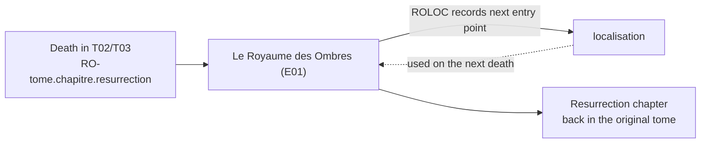

# Domain model: La Saga de Dagda

Vocabulary and game mechanics behind the app. French terms are the canonical
names and are kept untranslated in the UI and in the chapter data; this file
explains them so that feature work does not have to guess.

---

## Books

| Id    | Title                             | Registered with the app | In `BookId` |
| ----- | --------------------------------- | ----------------------- | ----------- |
| `T01` | La Harpe des Quatre Saisons       | yes                     | yes         |
| `T02` | La Confrérie de Nuada             | yes                     | yes         |
| `T03` | Les Entrailles du Temps           | yes                     | yes         |
| `T04` | La Prophétie Sombre               | yes                     | yes         |
| `T05` | L’Éveil des Oubliés               | yes                     | yes         |
| `E01` | Le Royaume des Ombres (extension) | yes                     | yes         |
| `E02` | Le Tumulus Abandonné (extension)  | no — `START`/`END` stub | no          |

`T01`–`T05` are the main _tomes_; `E01` and `E02` are extensions that a reader
may or may not own. Chapter data for `E01` contains `T04-…` references, and
book 4 is registered with the visualizer.

Each book is a numbered set of chapters (roughly 350) that the reader jumps
between. The app models a book as a directed graph of those chapters; the file
format is documented in [chapter-dsl.md](chapter-dsl.md).

`getBookData` parses a registered book into a shared, screen-independent
`BookData` model and memoizes it for the app session. The tree visualizer
projects that model into its graph and layout types; the Story Progresser uses
the same chapters and routes for navigation. Switching tabs does not parse the
book DSL again. Progress tracks store book/chapter positions rather than a copy
of the book data.

## Chapter mechanics

These are the things a chapter can do, and the DSL token that encodes each one.

- **Combat** (`F`) — a fight. The reader rolls against dexterity and applies
  weapon bonuses and damage. Automating this calculation is one of the app's
  stated goals. The Story Progresser provides a dice roller for one or two
  six-sided dice; two-die rolls show both faces and their sum. Rolls are
  temporary and are not associated with a track.
- **Énigme / Solution** (`QQ` / `QS`) — a riddle and the chapter holding its
  answer. The pair is joined by a _hidden_ path: its edge is drawn, but the
  answer chapter's label stays concealed until the reader searches for it.
- **Point de sauvegarde** (`S`) — a checkpoint. Its argument is the chapter to
  resume from after a death. Book 1's sheet has room for exactly three saves
  (`CharacterSheetBook1.save`).
- **Checkbox** (`C` / `TC`) — books print checkboxes next to certain chapters to
  record that an event happened. `C` marks a chapter that _has_ a checkbox;
  `TC` suggests ticking the boxes of the listed chapters.
- **Line checkbox** (`LC` / `TLC`) — `LC` declares a labeled line checkbox and
  contributes its first argument as a graph path. `TLC` suggests checking a
  matching line checkbox. Labels are case-sensitive; suggestions never change
  checkbox state automatically. Checked state is saved per reading track,
  separately from navigation history.
- **Lien vers un autre tome** (`T01`–`T99`) — the story continues in a different
  book at the given chapter.
- **Carte du monde** (`M`, `HM`, `MAP`) — `M` links a chapter to the map;
  `HM` adds a hidden map-to-chapter link for each referenced chapter, and the
  final `MAP` line defines the map node and its visible chapter paths. Repeated
  `HM` targets appear only once as hidden links.

## Le Royaume des Ombres

The realm of shadows is the death mechanic, shipped as extension `E01`. When a
reader dies, instead of simply restarting they play through the extension and
come back. Four tokens encode it:

- **`RO-<tome>.<chapitre>.<résurrection>`** — the entry point. It records which
  book and chapter the reader died in, and the chapter to return to when they
  leave the realm. Only the resurrection chapter produces a visible path.
- **`RRO-<chapitre>`** — content gated behind actually owning the extension. If
  the reader does not have it, they take the ordinary path instead.
- **`ROLOC-<chapitre>`** — _localisation_. The realm remembers where you were:
  this records the chapter to start from on your **next** visit, not this one.
  The character sheet holds a single `localisation` number.
- **`GT`** — _Goutte du Temps_, the time drop. Returns the reader to a chapter
  recorded earlier rather than a chapter named in the text.
- **`ROS-<chapitre>`** — a secret passage into a specific `E01` chapter, paired
  with a `T<nn>` token in the extension's own data.

The printed character sheet tracks up to 15 deaths, each a
`{ book, chapter, resurrection }` triple mirroring the three `RO` arguments.
The Story Progresser stores the RO return destination as part of the track's
visit history. It enters E01 at chapter 1 until a `ROLOC` chapter has been
visited; subsequent RO entries resume at the last saved localisation. An
explicit non-RO link or manual jump uses its specified chapter instead.

## Story progress tracking

The Story Progresser supports multiple named tracks in browser `localStorage`.
Each track has an ordered sequence of book/chapter visits, including revisits,
and its own checked boxes and revealed map paths.
The user can start a track in a tome, switch and rename tracks, delete a track,
undo the latest visit, follow visible chapter paths, or manually jump to any
registered book and chapter. Hidden paths are omitted from normal choices but
can be followed with a manual jump. References to unregistered books are shown
as unavailable. `MAP` is available as a special position. `HM` markers offer an action to
reveal their target chapter on the map; revealed paths are saved per track and
become selectable when the reader returns to the map.

The persisted path is screen-independent and can be reused by a future diagram
highlighting feature. Highlighting the tracked path in the tree visualizer is
not implemented.

## Character sheet

Not modelled in code yet — this section describes the printed sheets so that
whoever builds character-sheet features has the constraints to hand. The sheet
grows across the series, so a base shape plus per-book additions is the natural
modelling. Fields carry real constraints:

| Field                     | French label  | Notes                                                                                         |
| ------------------------- | ------------- | --------------------------------------------------------------------------------------------- |
| `currentLife` / `maxLife` | Points de vie |                                                                                               |
| `dexterity`               | Dextérité     | drives combat rolls                                                                           |
| `luck`                    | Chance        |                                                                                               |
| `constitution`            | Constitution  | from book 2 onwards                                                                           |
| `skill`                   | Talent        | a single talent in book 1, several afterwards; `level` only exists from book 3                |
| `weapons`                 | Armes         | each has a `name` and a `bonus`                                                               |
| `inventory`               | Inventaire    | max 24 slots in book 1, 14 afterwards                                                         |
| `gameMode`                | —             | `storytelling` \| `simplified` \| `deadly`, from book 2 onwards                               |
| `currentDamage`           | —             | from book 2 onwards; noted in the type as something that should be derived rather than stored |

Per-book additions:

- **Book 1**: three save slots.
- **Book 2**: `reputation` constrained to −5…+5, `daysPassed`, and
  `nextWakeUpEvent` — time and standing start to matter.
- **Book 3**: `shape` (fr. _état_), `status` (fr. _statut_ — apprenti, aîné) and
  `experience`.
- **Extension E01**: `localisation` plus the list of dead positions described
  above.

The character sheet, its persistence, and automated combat resolution are not
built. Story position and track persistence are implemented separately.

## What is built versus planned

Built: the shared parsed book model, chapter navigation through the
`story-progresser` tab, multiple locally persisted tracks, the chapter graph
for five tomes and E01, and the diagram viewer with zoom, pan, minimap and
chapter search.

Planned, per the README, and requiring the mechanics above:

- A working character sheet with per-book variants and persistence.
- Automatic combat resolution from dexterity, weapon bonus and game mode.
- Character-sheet integration with dice rolls.
- Support for the remaining unregistered extensions.

`BookData` in `src/services/bookData.ts` is the canonical parsed model used by
both screens. `bookGraph.ts` adapts it to the diagram graph; `storyNavigation.ts`
adapts it to reader choices. Diagram geometry and per-user progress are not
stored in `BookData`.
