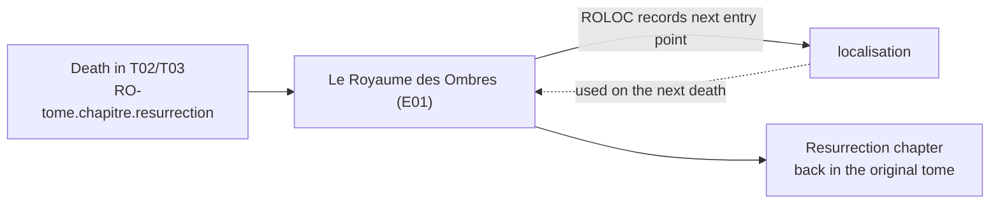

# Domain model: La Saga de Dagda

Vocabulary and game mechanics behind the app. French terms are the canonical
names and are kept untranslated in the UI and in the chapter data; this file
explains them so that feature work does not have to guess.

---

## Books

| Id | Title | Registered with the generator | In `BookIds` |
| --- | --- | --- | --- |
| `T01` | La Harpe des Quatre Saisons | yes | yes |
| `T02` | La Confrérie de Nuada | yes | yes |
| `T03` | Les Entrailles du Temps | yes | yes |
| `T04` | La Sombre Prophétie | no — `START`/`END` stub | no |
| `E01` | Le Royaume des Ombres (extension) | yes | yes |
| `E02` | Le Tumulus Abandonné (extension) | no — `START`/`END` stub | no |

`T01`–`T03` are the main *tomes*; `E01` and `E02` are extensions that a reader
may or may not own. Chapter data for `E01` already contains `T04-…` references,
so book 4 is expected to be wired in later.

Each book is a numbered set of chapters (roughly 350) that the reader jumps
between. The app models a book as a directed graph of those chapters; the file
format is documented in [chapter-dsl.md](chapter-dsl.md).

## Chapter mechanics

These are the things a chapter can do, and the DSL token that encodes each one.

- **Combat** (`F`) — a fight. The reader rolls against dexterity and applies
  weapon bonuses and damage. Automating this calculation is one of the app's
  stated goals; today the app only marks the chapter on the diagram.
- **Énigme / Solution** (`QQ` / `QS`) — a riddle and the chapter holding its
  answer. The pair is joined by an *invisible* Mermaid link (`~~~`) so that the
  layout is not distorted by an edge the reader is not supposed to follow.
- **Point de sauvegarde** (`S`) — a checkpoint. Its argument is the chapter to
  resume from after a death. Book 1's sheet has room for exactly three saves
  (`CharacterSheetBook1.save`).
- **Checkbox** (`C` / `TC`) — books print checkboxes next to certain chapters to
  record that an event happened. `C` marks a chapter that *has* a checkbox;
  `TC` is an instruction to go and tick the boxes of the listed chapters. This
  is the book's mechanism for persistent one-shot state.
- **Lien vers un autre tome** (`T01`–`T99`) — the story continues in a different
  book at the given chapter.

## Le Royaume des Ombres

The realm of shadows is the death mechanic, shipped as extension `E01`. When a
reader dies, instead of simply restarting they play through the extension and
come back. Four tokens encode it:

- **`RO-<tome>.<chapitre>.<résurrection>`** — the entry point. It records which
  book and chapter the reader died in, and the chapter to return to when they
  leave the realm. Only the resurrection chapter produces a visible path.
- **`RRO-<chapitre>`** — content gated behind actually owning the extension. If
  the reader does not have it, they take the ordinary path instead.
- **`ROLOC-<chapitre>`** — *localisation*. The realm remembers where you were:
  this records the chapter to start from on your **next** visit, not this one.
  The character sheet holds a single `localisation` number.
- **`GT`** — *Goutte du Temps*, the time drop. Returns the reader to a chapter
  recorded earlier rather than a chapter named in the text.
- **`ROS-<chapitre>`** — a secret passage into a specific `E01` chapter, paired
  with a `T<nn>` token in the extension's own data.

The reader tracks up to 15 deaths (`RoyaumeDesOmbresSheet.deadPositions`), each
one a `{ book, chapter, resurrection }` triple mirroring the three `RO`
arguments.

## Character sheet

Modelled in `src/types/characterSheet.ts`. The sheet grows across the series, so
the base `CharacterSheet` holds what every book shares and per-book types extend
it. Fields carry real constraints from the printed sheets:

| Field | French label | Notes |
| --- | --- | --- |
| `currentLife` / `maxLife` | Points de vie | |
| `dexterity` | Dextérité | drives combat rolls |
| `luck` | Chance | |
| `constitution` | Constitution | from book 2 onwards |
| `skill` | Talent | a single talent in book 1, several afterwards; `level` only exists from book 3 |
| `weapons` | Armes | each has a `name` and a `bonus` |
| `inventory` | Inventaire | max 24 slots in book 1, 14 afterwards |
| `gameMode` | — | `storytelling` \| `simplified` \| `deadly`, from book 2 onwards |
| `currentDamage` | — | from book 2 onwards; noted in the type as something that should be derived rather than stored |

Per-book additions:

- **Book 1** (`CharacterSheetBook1`): three save slots.
- **Book 2** (`CharacterSheetBook2`): `reputation` constrained to −5…+5,
  `daysPassed`, and `nextWakeUpEvent` — time and standing start to matter.
- **Book 3** (`CharacterSheetBook3`): `shape` (fr. *état*), `status` (fr.
  *statut* — apprenti, aîné) and `experience`.
- **Extension E01** (`RoyaumeDesOmbresSheet`): `localisation` plus the list of
  dead positions described above.

The types are more complete than the UI. `src/components/CharacterSheet/` is a
placeholder grid where every field, including list fields like inventory and
weapons, renders as `<Input type="number" />`, nothing is persisted, and the
`bookId` prop that should select the per-book variant is accepted but unused.

## What is built versus planned

Built: the chapter graph for four books, and the diagram viewer with zoom, pan,
minimap and chapter search.

Planned, per the README, and requiring the mechanics above:

- Tracking the reader's position through a book (the `story-progresser` tab).
- A working character sheet with per-book variants and persistence.
- Automatic combat resolution from dexterity, weapon bonus and game mode.
- Support for the remaining books and extensions.

Two unfinished pieces in `src/services/` are aimed at this. `chapter.ts` sketches
a runtime `Chapter` with `paths` and `actions` — a model of a chapter the app
could walk through, as opposed to `chapterType.ts`, which only describes how to
draw one. Neither is imported anywhere yet, and both export a type called
`ChapterType` with different meanings, so check which one you mean.
