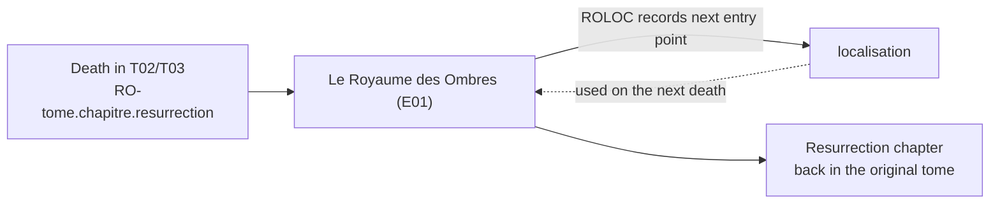

# Domain model: La Saga de Dagda

Vocabulary and game mechanics behind the app. French terms are the canonical
names and are kept untranslated in the UI and in the chapter data; this file
explains them so that feature work does not have to guess.

---

## Books

| Id    | Title                             | Registered with the app | In `BookId` |
| ----- | --------------------------------- | ----------------------- | ----------- |
| `T01` | La Harpe des Quatre Saisons       | yes                     | yes         |
| `T02` | La Confrérie de Nuada             | yes                     | yes         |
| `T03` | Les Entrailles du Temps           | yes                     | yes         |
| `T04` | La Prophétie Sombre               | yes                     | yes         |
| `T05` | L’Éveil des Oubliés               | yes                     | yes         |
| `E01` | Le Royaume des Ombres (extension) | yes                     | yes         |
| `E02` | Le Tumulus Abandonné (extension)  | no — `START`/`END` stub | no          |

`T01`–`T05` are the main _tomes_; `E01` and `E02` are extensions that a reader
may or may not own. Chapter data for `E01` contains `T04-…` references, and
book 4 is registered with the visualizer.

Each book is a numbered set of chapters (roughly 350) that the reader jumps
between. The app models a book as a directed graph of those chapters; the file
format is documented in [chapter-dsl.md](chapter-dsl.md).

`getBookData` parses a registered book into a shared, screen-independent
`BookData` model and memoizes it for the app session. The tree visualizer
projects that model into its graph and layout types; the Story Progresser uses
the same chapters and routes for navigation. Switching tabs does not parse the
book DSL again. Progress tracks store book/chapter positions rather than a copy
of the book data.

## Chapter mechanics

These are the things a chapter can do, and the DSL token that encodes each one.

- **Combat** (`F`) — a fight. The reader rolls against dexterity and applies
  weapon bonuses and damage. Automating this calculation is one of the app's
  stated goals. The Story Progresser provides a dice roller for one or two
  six-sided dice; two-die rolls show both faces and their sum. Rolls are
  temporary and are not associated with a track.
- **Énigme / Solution** (`QQ` / `QS`) — a riddle and the chapter holding its
  answer. The pair is joined by a _hidden_ path: its edge is drawn, but the
  answer chapter's label stays concealed until the reader searches for it.
- **Point de sauvegarde** (`S`) — a checkpoint. Its argument is the chapter to
  resume from after a death. Each book has three save slots per track, usable
  only in Simplified mode. For T01, an `S` marker can set the chapter to resume
  from; elsewhere, a save resumes at the chapter where it was created.
- **Checkbox** (`C` / `TC`) — books print checkboxes next to certain chapters to
  record that an event happened. `C` marks a chapter that _has_ a checkbox;
  `TC` suggests ticking the boxes of the listed chapters.
- **Line checkbox** (`LC` / `TLC`) — `LC` declares a labeled line checkbox and
  contributes its first argument as a graph path. `TLC` suggests checking a
  matching line checkbox. Labels are case-sensitive; suggestions never change
  checkbox state automatically. Checked state is saved per reading track,
  separately from navigation history.
- **Lien vers un autre tome** (`T01`–`T99`) — the story continues in a different
  book at the given chapter.
- **Carte du monde** (`M`, `HM`, `MAP`) — `M` links a chapter to the map;
  `HM` adds a hidden map-to-chapter link for each referenced chapter, and the
  final `MAP` line defines the map node and its visible chapter paths. Repeated
  `HM` targets appear only once as hidden links.

## Le Royaume des Ombres

The realm of shadows is the death mechanic, shipped as extension `E01`. When a
reader dies, instead of simply restarting they play through the extension and
come back. Four tokens encode it:

- **`RO-<tome>.<chapitre>.<résurrection>`** — the entry point. It records which
  book and chapter the reader died in, and the chapter to return to when they
  leave the realm. Only the resurrection chapter produces a visible path.
- **`RRO-<chapitre>`** — content gated behind actually owning the extension. If
  the reader does not have it, they take the ordinary path instead.
- **`ROLOC-<chapitre>`** — _localisation_. The realm remembers where you were:
  this records the chapter to start from on your **next** visit, not this one.
  The character sheet holds a single `localisation` number.
- **`GT`** — _Goutte du Temps_, the time drop. Returns the reader to a chapter
  recorded earlier rather than a chapter named in the text.
- **`ROS-<chapitre>`** — a secret passage into a specific `E01` chapter, paired
  with a `T<nn>` token in the extension's own data.

The E01 character sheet tracks up to 15 deaths, each recording the origin tome,
death chapter, and resurrection chapter from an `RO` route. The Story Progresser
stores the RO return destination as part of the track's visit history. It enters
E01 at chapter 1 until a `ROLOC` chapter has been visited; subsequent RO entries
resume at the saved localisation. An explicit non-RO link or manual jump uses
its specified chapter instead.

## Story progress tracking

The Story Progresser supports multiple named tracks in browser `localStorage`.
Each track has an ordered sequence of book/chapter visits, including revisits,
and its own checked boxes and revealed map paths.
The user can start a track in a tome, switch and rename tracks, delete a track,
undo the latest visit, follow visible chapter paths, or manually jump to any
registered book and chapter. Hidden paths are omitted from normal choices but
can be followed with a manual jump. References to unregistered books are shown
as unavailable. `MAP` is available as a special position. `HM` markers offer an action to
reveal their target chapter on the map; revealed paths are saved per track and
become selectable when the reader returns to the map.

The persisted path is screen-independent and can be reused by a future diagram
highlighting feature. Highlighting the tracked path in the tree visualizer is
not implemented.

## Character sheets

The Story Progresser has editable, per-track sheets for T01–T05 and E01. Sheets
are saved with the track in `localStorage`; a track can have a separate sheet
for every visited book. Returning to a visited book resumes its existing sheet.
The game mode is chosen when creating a track and follows it between books.

- **T01** records life points, dexterity, luck, one skill, free-form weapon and
  feature modifiers, and an inventory of up to 24 distinct entries. Its three
  save slots snapshot the T01 fields and game mode; restoring a slot restores
  that snapshot and adds a visit to its resume chapter.
- **T02** adds constitution, a second skill, weapons with bonuses, current
  damage, reputation (−5…+5), four passed-day checkboxes, and the next wake-up
  chapter.
- **T03** gives skills a level (starting at 1), and adds state, status, and
  experience (left blank until entered, with 0 shown as a placeholder).
- **T04** adds three prophecy-fragment checkboxes.
- **T01–T04** carry shared stats when first entering a new main tome. The
  destination's fields are initialized as needed, including skill levels and
  experience. Inventory is limited to 14 distinct entries from T02 onwards;
  extra entries remain in a separate carried list rather than being discarded.
- **T05** is isolated from main-tome conversion. It records body, mind, charisma,
  life points, unlimited money, up to 12 inventory titles, three audacity
  checkboxes, one weapon, one protection item, and an unlimited ordered memory
  list. Characteristics are constrained to 4–10. Memories may be sorted for
  display without changing their saved order.
- **E01** has a persistent localisation and up to 15 capsules. A full capsule
  list blocks further RO entries until one is removed. It does not have a
  general character sheet.

The T01 DSL currently contains no `S` markers, so the reader can create a
snapshot at the current T01 chapter; when an `S` marker is present, its target
chapter is used as the resume location. These sheets do not yet automate combat
resolution or connect character stats to dice rolls.

## What is built versus planned

Built: the shared parsed book model, chapter navigation through the
`story-progresser` tab, multiple locally persisted tracks and character sheets,
the chapter graph for five tomes and E01, and the diagram viewer with zoom,
pan, minimap and chapter search.

Planned, per the README, and requiring the mechanics above:

- Automatic combat resolution from dexterity, weapon bonus and game mode.
- Character-sheet integration with dice rolls.
- Support for the remaining unregistered extensions.

`BookData` in `src/services/bookData.ts` is the canonical parsed model used by
both screens. `bookGraph.ts` adapts it to the diagram graph; `storyNavigation.ts`
adapts it to reader choices. Diagram geometry and per-user progress are not
stored in `BookData`.
